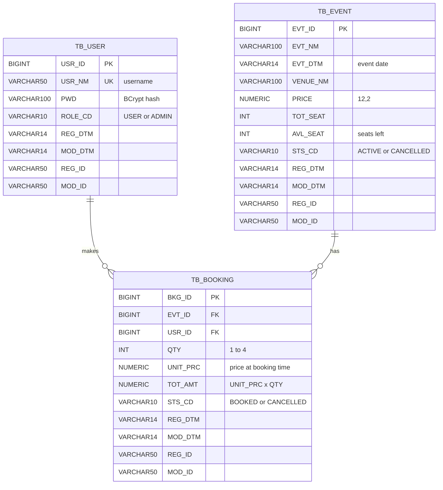

# ERD – Database design

**Database:** PostgreSQL 17 · **Schema managed by:** Flyway (`eventtickets/src/main/resources/db/migration`)

## Diagram

- **One user** makes **many bookings**; **one event** has **many bookings**.
- `TB_USER` and `TB_EVENT` are **master tables** (things that exist on their own).
- `TB_BOOKING` is the **transaction table**: it records what happens between them, and every business rule touches it.

## Tables

### TB_USER – users and their role

| Column | Type | Null | Key | Description |
|---|---|---|---|---|
| USR_ID | BIGINT identity | no | **PK** | User id |
| USR_NM | VARCHAR(50) | no | **UK** | Username (unique) |
| PWD | VARCHAR(100) | no | | BCrypt password hash |
| ROLE_CD | VARCHAR(10) | no | | `USER` or `ADMIN` |
| REG_DTM, MOD_DTM | VARCHAR(14) | no | | Created / modified, `YYYYMMDDHH24MISS` |
| REG_ID, MOD_ID | VARCHAR(50) | no | | Created / modified by (username or `system`) |

### TB_EVENT – events

| Column | Type | Null | Key | Description |
|---|---|---|---|---|
| EVT_ID | BIGINT identity | no | **PK** | Event id |
| EVT_NM | VARCHAR(100) | no | | Event name |
| EVT_DTM | VARCHAR(14) | no | | Event date and time |
| VENUE_NM | VARCHAR(100) | no | | Venue |
| PRICE | NUMERIC(12,2) | no | | Ticket price, `CHECK (PRICE >= 0)` |
| TOT_SEAT | INT | no | | Total seats, `CHECK (TOT_SEAT > 0)` |
| AVL_SEAT | INT | no | | Seats left, `CHECK (AVL_SEAT >= 0)` and `CHECK (AVL_SEAT <= TOT_SEAT)` |
| STS_CD | VARCHAR(10) | no | | `ACTIVE` or `CANCELLED` |
| + audit columns | | | | as above |

### TB_BOOKING – bookings

| Column | Type | Null | Key | Description |
|---|---|---|---|---|
| BKG_ID | BIGINT identity | no | **PK** | Booking id |
| EVT_ID | BIGINT | no | **FK** → TB_EVENT | Booked event |
| USR_ID | BIGINT | no | **FK** → TB_USER | Customer |
| QTY | INT | no | | Tickets, `CHECK (QTY BETWEEN 1 AND 4)` |
| UNIT_PRC | NUMERIC(12,2) | no | | Event price at booking time |
| TOT_AMT | NUMERIC(12,2) | no | | `UNIT_PRC × QTY`, calculated by the server |
| STS_CD | VARCHAR(10) | no | | `BOOKED` or `CANCELLED` |
| + audit columns | | | | as above |

## Keys and indexes

| Index | Table (column) | Created by | Why |
|---|---|---|---|
| `tb_user_pkey` | TB_USER(USR_ID) | PostgreSQL, for the PK | Find a user by id |
| `tb_user_usr_nm_key` | TB_USER(USR_NM) | PostgreSQL, for the UNIQUE constraint | Fast login lookup; no duplicate usernames |
| `tb_event_pkey` | TB_EVENT(EVT_ID) | PostgreSQL, for the PK | Find an event by id |
| `tb_booking_pkey` | TB_BOOKING(BKG_ID) | PostgreSQL, for the PK | Find a booking by id |
| `ix_bkg_usr` | TB_BOOKING(USR_ID) | **us** (V1 migration) | "My bookings" (`WHERE USR_ID = ?`) |
| `ix_bkg_evt` | TB_BOOKING(EVT_ID) | **us** (V1 migration) | Bookings of an event, joins |

PostgreSQL creates an index automatically for primary keys and unique constraints, but **not** for foreign keys,
so the two foreign key columns we search by are indexed manually.

## Constraints that protect the business rules

| Constraint | Protects |
|---|---|
| `CHECK (AVL_SEAT >= 0)` | BR-01 No overbooking (last safety net behind the row lock) |
| `CHECK (AVL_SEAT <= TOT_SEAT)` | BR-02 Seats stay correct |
| `CHECK (QTY BETWEEN 1 AND 4)` | BR-03 Max 4 tickets |
| `FOREIGN KEY (EVT_ID)`, `(USR_ID)` | A booking always points to a real event and user |
| `UNIQUE (USR_NM)` | One account per username |

## Design decisions

| Decision | Reason |
|---|---|
| Role as a column, not a role table | Each user has exactly one role. If users needed several roles: add `TB_ROLE` + `TB_USER_ROLE` (many-to-many) |
| `NUMERIC(12,2)` for money | Exact decimals; floating point has rounding errors |
| `VARCHAR(14)` dates | Company convention (slide 22); sorts correctly as text |
| `UNIT_PRC` stored in the booking | The price paid stays correct if the event price changes later |
| Status instead of DELETE | Cancelled events and bookings are kept for history |
| `AVL_SEAT` stored, not calculated | Fast reads and a single row to lock during booking |

## Migrations

| Version | File | Does |
|---|---|---|
| V1 | `V1__create_tables.sql` | Creates the 3 tables, constraints and indexes |
| V2 | `V2__seed_data.sql` | Demo users (admin, alice, bob) and 3 events (100 seats, 5 seats, one CANCELLED) |

Never edit a migration that has run; add `V3__…sql` for changes.
